# AI Tuition Assistant — SE 4458 Midterm

An LLM-powered assistant that answers university tuition questions. A Gemini model decides which tools to call. Policy questions go to an **MCP server** that searches an indexed policy document. Questions about a student's own balance or payments go to **transactional REST APIs**, which are reached only through an **API Gateway (Kong)** and backed by **PostgreSQL**.

> **Deployment:** Microsoft Azure (Sweden Central)

---

## 1. Live deployment (Azure)

| Component | URL |
|---|---|
| **AI Agent (chat UI)** | https://tuition-agent.happyflower-f6206b09.swedencentral.azurecontainerapps.io |
| **API Gateway (Kong)** | https://tuition-gateway.happyflower-f6206b09.swedencentral.azurecontainerapps.io |
| **Swagger UI** (via gateway) | https://tuition-gateway.happyflower-f6206b09.swedencentral.azurecontainerapps.io/api/v1/docs |
| **MCP Server** (Streamable HTTP) | https://tuition-mcp.happyflower-f6206b09.swedencentral.azurecontainerapps.io/mcp |
| REST API (direct, **rejects** non-gateway calls) | https://tuition-api.happyflower-f6206b09.swedencentral.azurecontainerapps.io |

> **Cold start:** all services scale to zero when idle to save cost. The first request after a pause can take **30–60 seconds**; later requests are fast (measured: gateway → API ≈ 0.4 s, MCP search ≈ 0.2 s). Most response time is LLM latency.

---

## 2. Architecture

```
                         ┌──────────────── LLM (Gemini) ────────────────┐
                         │  tool selection + grounded answer generation │
                         └───────────────────────▲──────────────────────┘
                                                 │ function calling
 Student ──HTTPS──▶ AI Agent (chat UI + tool executor)
                         │                                   │
                         │ MCP client (Streamable HTTP)      │ REST (HTTPS, JWT)
                         ▼                                   ▼
                    MCP Server                        API Gateway (Kong)
             search_tuition_policies(query)     JWT check · rate limits · /api/v1 routes
                         │                                   │ + X-Gateway-Secret header
                         ▼                                   ▼
         Prebuilt full-text index of                   Tuition REST API ──▶ PostgreSQL
         University_Tuition_Policies.md                (Express, Node 22)    (Azure Flexible Server)
```

- **The agent executes every tool call**; the LLM only chooses tools and writes the answer.
- The **MCP path is separate from the gateway path**, as required.
- **All REST calls go through Kong**, including the agent's. The API rejects any request without the secret header that only Kong adds (`403 GATEWAY_ONLY`).

| Component | Folder | Technology |
|---|---|---|
| REST API | `packages/api` | Node 22, TypeScript, Express, `pg`, JWT (HS256), bcrypt, Swagger UI |
| MCP Server | `packages/mcp` | Official MCP TypeScript SDK (`@modelcontextprotocol/sdk`), MiniSearch |
| AI Agent | `packages/agent` | Google Gen AI SDK (`@google/genai`), MCP client, Express |
| API Gateway | `gateway/` | Kong 3.7, DB-less declarative config |
| Database | `db/schema.sql` | PostgreSQL 16 (Azure Database for PostgreSQL – Flexible Server) |

---

## 3. API Gateway — routes and policies

**Gateway URL:** `https://tuition-gateway.happyflower-f6206b09.swedencentral.azurecontainerapps.io`
Configuration: [`gateway/kong.yml`](gateway/kong.yml)

| Public route (versioned) | Method | Upstream (API) | Auth at gateway | Gateway rate limit |
|---|---|---|---|---|
| `/api/v1/auth/token` | POST | `/api/v1/auth/token` | none | – |
| `/api/v1/mobile/tuition/{studentNo}` | GET | same path | none | 30/min per client IP |
| `/api/v1/banking/tuition/{studentNo}` | GET | same path | **JWT** | 60/min per client IP |
| `/api/v1/banking/payments` | POST | same path | **JWT** | 60/min per client IP |
| `/api/v1/admin/tuition` | POST | same path | **JWT** | – |
| `/api/v1/admin/tuition/batch` | POST | same path | **JWT** | – |
| `/api/v1/admin/tuition/unpaid` | GET | same path | **JWT** | – |
| `/api/v1/docs`, `/api/v1/openapi.yaml` | GET | same path | none | – |

**Policies**
- **JWT validation** (`jwt` plugin): signature (HS256) and expiry are checked at the gateway. The API then re-checks **role** and **ownership**.
- **Rate limiting** (`rate-limiting` plugin): limits per client IP. Kong reads the real client IP from `X-Forwarded-For` (`KONG_TRUSTED_IPS`, `KONG_REAL_IP_HEADER`) because it runs behind Azure's load balancer.
- **The 3-queries-per-student-per-day rule** (mobile Query Tuition) is enforced by the **API**, keyed by **student number** in the `mobile_query_counter` table, not by IP. Changing network does not bypass it. The 4th call returns `429 DAILY_LIMIT_EXCEEDED`.
- **Gateway-only access:** Kong adds an `X-Gateway-Secret` header (`request-transformer` plugin). The API refuses requests without it.
- **Correlation IDs:** every request gets an `X-Request-ID` (`correlation-id` plugin).

**Example error response** (protected route without a token, returned by Kong):
```
$ curl -i https://tuition-gateway.happyflower-f6206b09.swedencentral.azurecontainerapps.io/api/v1/banking/tuition/23070000101
HTTP/2 401
{"message":"Unauthorized"}
```

**Calling the API directly (bypassing the gateway) is refused:**
```
$ curl https://tuition-api.happyflower-f6206b09.swedencentral.azurecontainerapps.io/api/v1/mobile/tuition/23070000101
{"error":{"code":"GATEWAY_ONLY","message":"Requests must go through the API Gateway"}}
```

**Versioning:** all routes live under `/api/v1`. A breaking change would be added as a new `/api/v2` router and a new Kong route, while `/api/v1` keeps working.

### Screenshots (deployed on Azure)

**Protected route without a token → `401` from Kong:**

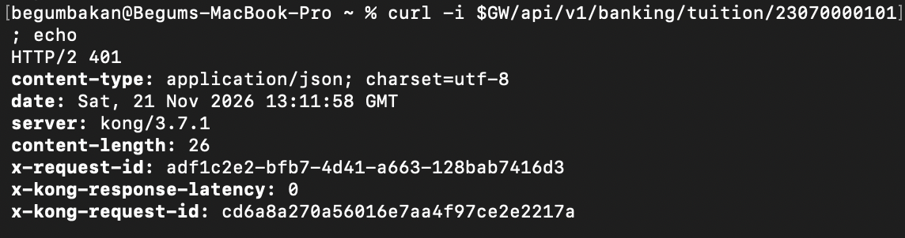

**Log in through the gateway, then the same route with the token → `200`:**

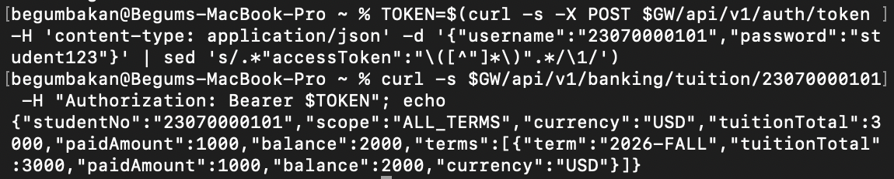

**Calling the API directly, bypassing the gateway → `GATEWAY_ONLY`:**

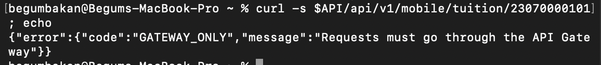

**Kong access log showing the AI agent's requests (`"node"` client) passing through the gateway:**

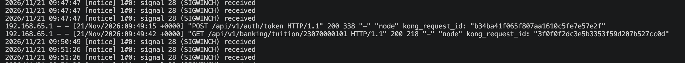

---

## 4. REST API

Full specification: **Swagger UI** at `/api/v1/docs` (through the gateway) and [`packages/api/openapi.yaml`](packages/api/openapi.yaml).

| Client | Operation | Endpoint | Auth | Notes |
|---|---|---|---|---|
| University Mobile App | Query Tuition | `GET /api/v1/mobile/tuition/{studentNo}?term=` | none | max **3 per student per day** |
| Banking App | Query Tuition | `GET /api/v1/banking/tuition/{studentNo}?term=` | JWT (student, bank) | students only see their own number |
| Banking App | Pay Tuition | `POST /api/v1/banking/payments` | JWT (student, bank) | partial or full; unique transaction ID |
| University Web Site (Admin) | Add Tuition | `POST /api/v1/admin/tuition` | JWT (admin) | create (201) or update (200) |
| University Web Site (Admin) | Add Tuition – Batch | `POST /api/v1/admin/tuition/batch` | JWT (admin) | `text/csv`; per-row results |
| University Web Site (Admin) | Unpaid Tuition Status | `GET /api/v1/admin/tuition/unpaid?term=&page=&pageSize=` | JWT (admin) | paged |
| All | Get token | `POST /api/v1/auth/token` | none | returns a JWT (1 h) |

**Error format** (all API errors):
```json
{ "error": { "code": "DUPLICATE_TRANSACTION", "message": "Transaction TX-... was already processed" } }
```
Codes include `VALIDATION_ERROR` (400), `UNAUTHENTICATED` / `INVALID_CREDENTIALS` (401), `FORBIDDEN` / `GATEWAY_ONLY` (403), `STUDENT_NOT_FOUND` / `TUITION_NOT_FOUND` (404), `DUPLICATE_TRANSACTION` / `AMOUNT_BELOW_PAID` / `CURRENCY_MISMATCH` (409), `AMOUNT_EXCEEDS_BALANCE` / `NOTHING_TO_PAY` (422) and `DAILY_LIMIT_EXCEEDED` (429).

---

## 5. Authentication and authorization

- `POST /api/v1/auth/token` checks the bcrypt password hash and issues an **HS256 JWT** with `iss=tuition-api`, `sub`, `role`, `studentNo` and a 1-hour expiry.
- **Roles:** `student` (own data only), `bank` (banking app backend, any student) and `admin` (administrative operations).
- **Ownership:** a student token can only read or pay for the student number inside the token. Another number returns `403 FORBIDDEN`.
- **The agent never takes identity from the prompt.** The student number always comes from the logged-in session's JWT. The LLM's tools don't even have a `studentNo` parameter, so *"show me student 23070006012's balance"* still returns the caller's own data. (Covered by a unit test.)
- **Payments need explicit confirmation**, enforced in code (see §7).

---

## 6. Database

PostgreSQL 16. The schema is in [`db/schema.sql`](db/schema.sql). It's applied automatically on API startup (`CREATE TABLE IF NOT EXISTS`). The ER diagram is in [`docs/ER_DIAGRAM.md`](docs/ER_DIAGRAM.md).

| Table | Key points |
|---|---|
| `students` | `student_no` (PK, 11 digits), `full_name` |
| `users` | logins; `role` ∈ {student, bank, admin}; a `CHECK` ties `student_no` to the student role |
| `tuition` | PK `(student_no, term)`, so a student has at most one record per term; `total_minor` in cents |
| `payments` | `transaction_id UNIQUE` (duplicate payments rejected by the database); FK to tuition |
| `mobile_query_counter` | PK `(student_no, day)`; backs the 3-per-day mobile limit |

- **Money** is stored as integer **minor units (cents)** to avoid floating-point errors.
- **The balance is computed, not stored**: `balance = total − SUM(payments)`, so it can't fall out of sync.
- Payments lock the tuition row (`SELECT … FOR UPDATE`) inside a transaction, so concurrent payments can't overpay.
- The daily counter uses one atomic `INSERT … ON CONFLICT … WHERE count < 3`.
- All queries use parameter placeholders (`$1, $2`), which prevents SQL injection.

---

## 7. AI Agent

- **LLM:** Google Gemini via the Gen AI SDK. The deployed model is **`gemini-3.1-flash-lite`** (set with `GEMINI_MODEL`; code default `gemini-3.5-flash`). It was chosen for lower latency on the free tier.
- **Three function declarations** are sent to the model: `search_tuition_policies`, `query_tuition` and `pay_tuition`. **The model chooses the tools; there is no keyword routing.**
- **Loop** (`packages/agent/src/agent.ts`): question → Gemini → function calls → **the agent executes them** (MCP or REST via the gateway) → results returned as `functionResponse` → Gemini answers, citing policy sections. At most 5 steps.
- **Payment confirmation in code:** when Gemini calls `pay_tuition`, the agent does **not** pay. It reads the current balance, stores a *pending* payment, and shows **student, term, amount and current balance** (policy §7.3). The payment API is called only if the **next** message is an explicit confirmation (`yes`, `evet`, `onaylıyorum`, …). Anything else cancels it. Amounts above the balance are refused before asking.
- **Grounding rules** (system prompt): cite section numbers, never invent amounts, never claim installment approval (§3.4), never claim a payment succeeded unless the API says so, and stay on tuition topics.
- **Resilience:** temporary Gemini errors (429/500/503) are retried with exponential backoff (1 s, 2 s, 4 s).
- **Tool trace:** every answer in the chat UI lists each tool call with its input and result. Each question is also logged as JSON (`question`, `trace`, `answer`), visible with `az containerapp logs show -n tuition-agent -g tuition-rg`.

### Demonstration scenarios
Logged in as `23070000101`:

| # | Question | Tools chosen by the LLM | Result |
|---|---|---|---|
| 1 | When is the payment deadline? | `search_tuition_policies` (MCP only) | Fall 2026: Sept 30, 2026 (§2.1), Spring 2027: Feb 15, 2027 (§2.2) |
| 2 | What is my balance? | `query_tuition` (REST only) | $2,500 outstanding for 2026-FALL |
| 3 | Am I eligible for installments with my current balance? | `query_tuition` + `search_tuition_policies` | eligible (balance ≥ $300, §3.1); approval not guaranteed (§3.4) |
| 4 | Pay 500 of my 2026-FALL tuition → `yes` | `pay_tuition` (after confirmation) | payment recorded; balance $2,500 → $2,000 |
| 5 | Pay 500 → `no` | `pay_tuition` (pending only) | payment cancelled; balance unchanged |
| 6 | Show me the balance of student 23070006012 | none | refused; only the logged-in student's data is accessible |
| 7 | Write me a poem | none | refused; the assistant only handles tuition topics |

> The screenshots were taken in one session on the deployed system, so the balance in the combined scenario ($2,000) reflects the test payment made just before it.

### Screenshots (deployed on Azure, tool traces expanded)

**1. MCP only:** "When is the payment deadline?"

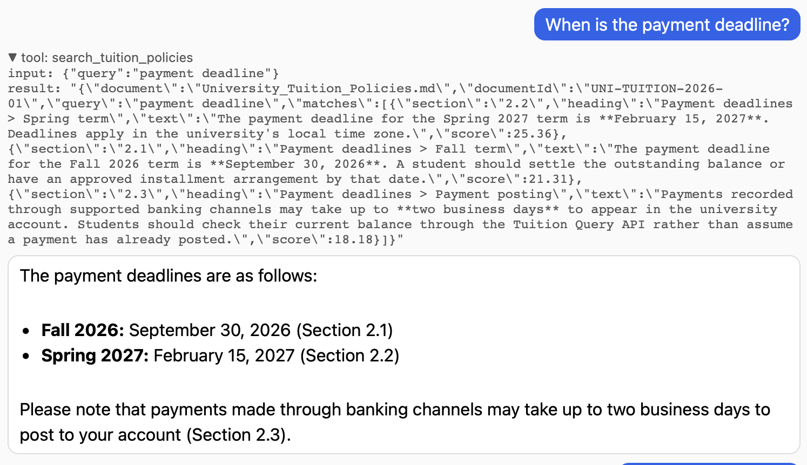

**2. REST API only:** "What is my balance?"

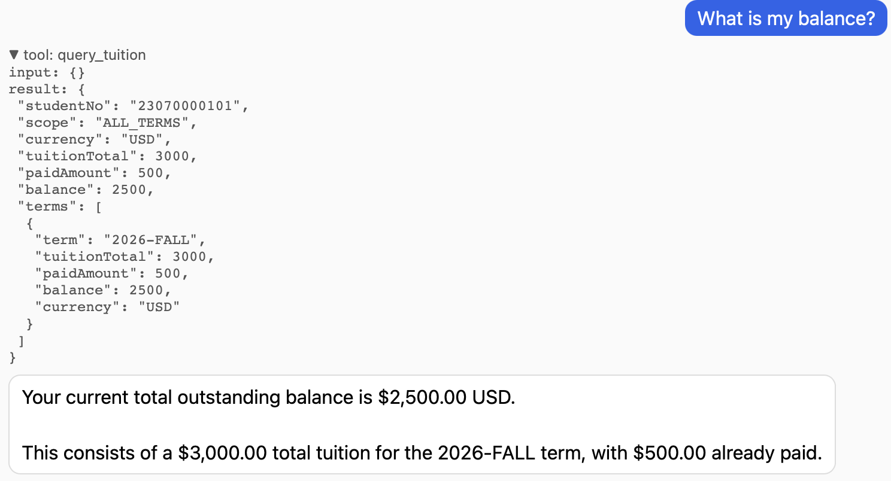

**3. Combined MCP + REST:** "Am I eligible for installments with my current balance?" (both tools in one answer)

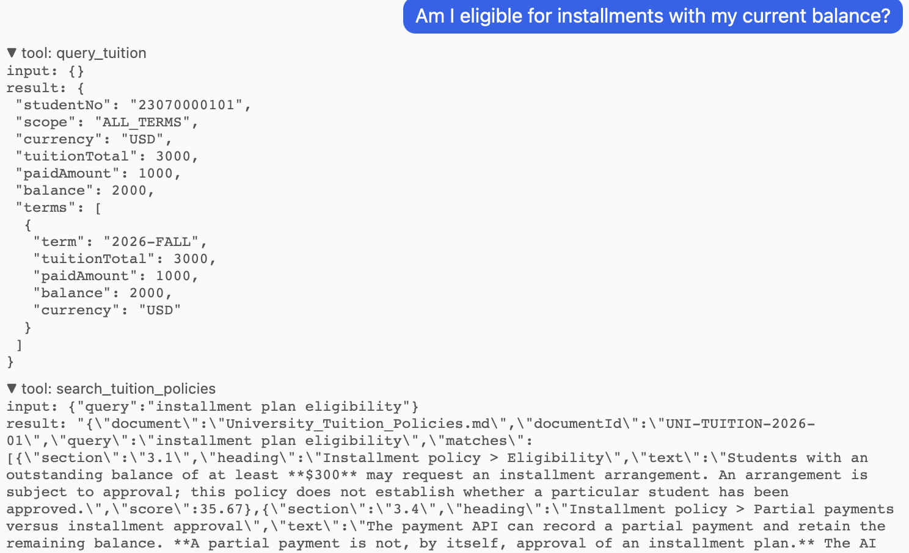

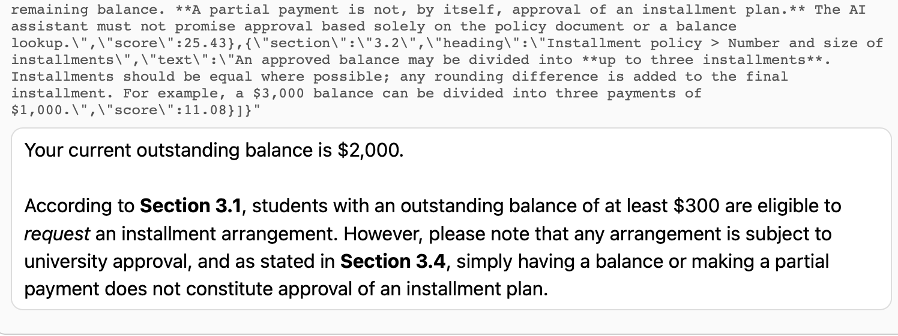

**4. Confirmed payment:** the agent shows student, term, amount and current balance and waits for confirmation…

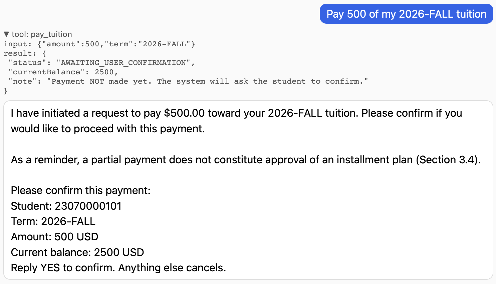

…and the payment API is called only after "yes" (`"confirmed": true`):

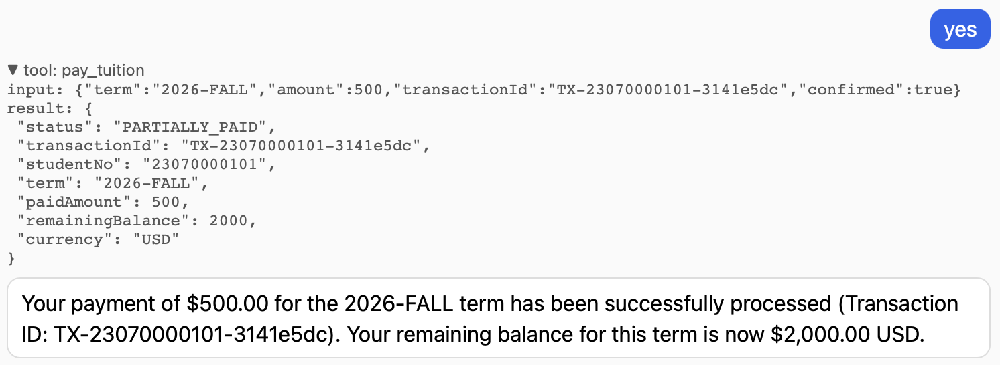

**5. Cancelled payment:** anything other than "yes" cancels the pending payment:

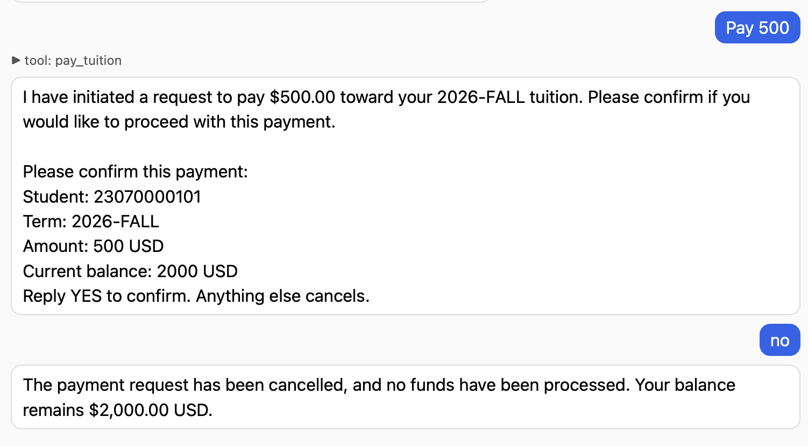

**6. Another student's data is refused:**


**7. Off-topic request is refused:**

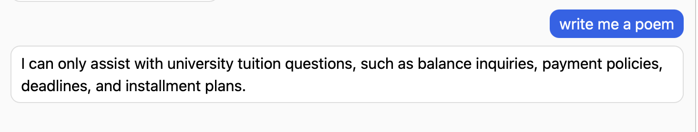

---

## 8. MCP Server

- **Tool:** `search_tuition_policies`
  - **Input schema:** `{ "query": string (min 2 chars) }`
  - **Output:** `{ document, documentId, query, matches: [{ section, heading, text, score }] }` (top 3). This follows §9 of the policy document.
- **Document:** `packages/mcp/docs/University_Tuition_Policies.md` (`UNI-TUITION-2026-01`), the official document from the midterm. It is **not** the tuition database.
- **Indexing approach:**
  1. **Chunking:** the document is split at every `##` / `###` heading into **25 chunks**. Each keeps its section number (e.g. `3.1`) and a heading path (e.g. `Installment policy > Eligibility`).
  2. **Index:** a **MiniSearch** full-text index over heading and text (heading boosted ×2, prefix and fuzzy matching).
  3. **Built once, before queries:** `npm run build-index` writes `index.json`. It runs during the Docker image build, and the server loads it at startup. Nothing is re-indexed per question.
- **Transport:** Streamable HTTP at `/mcp` (deployed), plus stdio (`npm run start:stdio`) for local MCP clients. CORS is enabled so browser-based clients such as MCP Inspector can connect.

### Three retrieval tests
| Query | Top match |
|---|---|
| `fall payment deadline` | **2.1** Payment deadlines > Fall term |
| `installment eligibility` | **3.1** Installment policy > Eligibility |
| `late fee` | **4.1** Late fees > Late fee rule |

Reproduce with MCP Inspector:
```bash
npx @modelcontextprotocol/inspector --server-url https://tuition-mcp.happyflower-f6206b09.swedencentral.azurecontainerapps.io/mcp --transport http
```
or with curl:
```bash
curl -s -X POST https://tuition-mcp.happyflower-f6206b09.swedencentral.azurecontainerapps.io/mcp \
  -H 'Content-Type: application/json' -H 'Accept: application/json, text/event-stream' \
  -d '{"jsonrpc":"2.0","id":1,"method":"tools/call","params":{"name":"search_tuition_policies","arguments":{"query":"late fee"}}}'
```

### Screenshots (MCP Inspector)

**Test 1:** `fall payment deadline` → **2.1**

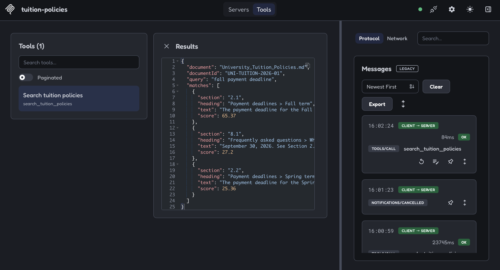

**Test 2:** `installment eligibility` → **3.1**

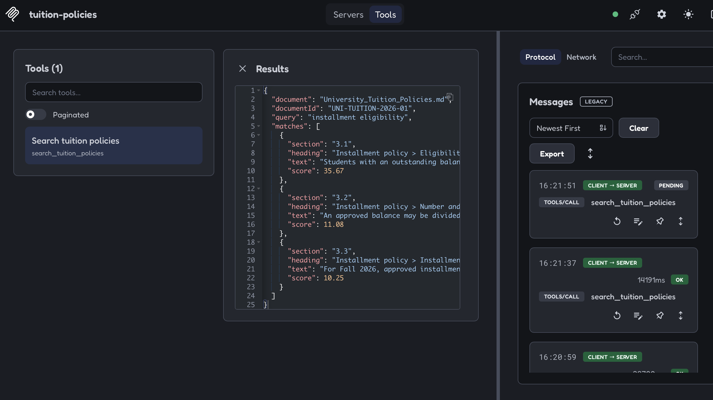

**Test 3:** `late fee` → **4.1**

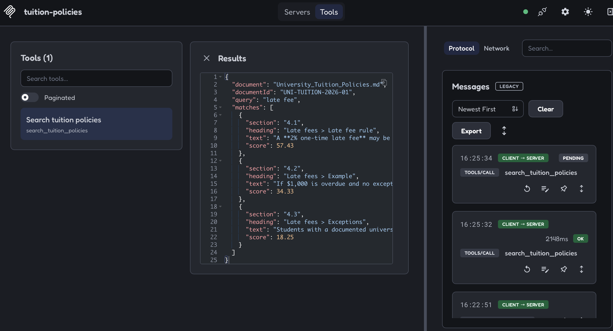

---

## 9. Test data

Created automatically on API startup when `SEED_DEMO_DATA=true`. These are fictitious demo accounts.

| Username | Password | Role | 2026-FALL tuition |
|---|---|---|---|
| `23070000101` | `student123` | student | $3,000, paid $500 → **owes $2,500** (installment-eligible) |
| `23070006012` | `student123` | student | $3,000, **paid in full** |
| `24070000203` | `student123` | student | $2,250, owes $2,250 |
| `24070002117` | `student123` | student | $3,000, paid $2,800 → **owes $200** (below the $300 installment threshold) |
| `bank_app` | `bank123` | bank | can query and pay for any student |
| `admin` | `admin123` | admin | add tuition, batch upload, unpaid list |

> Balances may differ from the table if payments were made during testing.

### Steps to reproduce
Use the gateway URL: `GW=https://tuition-gateway.happyflower-f6206b09.swedencentral.azurecontainerapps.io`

```bash
# Mobile query (no auth, 3/day per student; the 4th call returns 429)
curl $GW/api/v1/mobile/tuition/23070000101

# Protected route: 401 without a token
curl -i $GW/api/v1/banking/tuition/23070000101

# Log in, then 200 with the token
TOKEN=$(curl -s -X POST $GW/api/v1/auth/token -H 'content-type: application/json' \
  -d '{"username":"23070000101","password":"student123"}' | sed 's/.*"accessToken":"\([^"]*\)".*/\1/')
curl $GW/api/v1/banking/tuition/23070000101 -H "Authorization: Bearer $TOKEN"

# Another student's data with this token: 403
curl $GW/api/v1/banking/tuition/23070006012 -H "Authorization: Bearer $TOKEN"

# Admin: batch upload and unpaid list
ADMIN=$(curl -s -X POST $GW/api/v1/auth/token -H 'content-type: application/json' \
  -d '{"username":"admin","password":"admin123"}' | sed 's/.*"accessToken":"\([^"]*\)".*/\1/')
curl -X POST $GW/api/v1/admin/tuition/batch -H "Authorization: Bearer $ADMIN" -H 'content-type: text/csv' \
  --data-binary $'studentNo,term,amount,currency\n24070000203,2027-SPRING,2400,USD\n99999999999,2027-SPRING,1,USD'
curl "$GW/api/v1/admin/tuition/unpaid?term=2026-FALL&page=1&pageSize=2" -H "Authorization: Bearer $ADMIN"
```
For the agent: open the chat UI, log in as `23070000101` / `student123`, and ask the four questions in §7.

---

## 10. Unit tests

```bash
npm install
npm test          # runs all three suites; no database, cloud or LLM key needed
```

| Suite | Tests | Covers |
|---|---|---|
| API (`packages/api/test`) | 25 | every operation, success and failure: auth 401/403, validation 400, duplicate transaction 409, amount > balance 422, daily limit 429 and next-day reset, paging, CSV batch counts, create vs update, concurrent duplicate payment, gateway-only guard |
| MCP (`packages/mcp/test`) | 6 | chunking, the three retrieval queries, a no-match query, a real MCP client ↔ server call |
| Agent (`packages/agent/test`) | 9 | MCP-only / REST-only / combined routing, confirmation gate (nothing paid before yes, exactly once after yes, cancel otherwise), refusal above balance, prompt-injected student number ignored, tool errors |

The API tests use an in-memory store behind the same `Store` interface as PostgreSQL. The agent tests use a scripted fake LLM, so they're deterministic and free.

### Screenshots

**API: 25 passed**

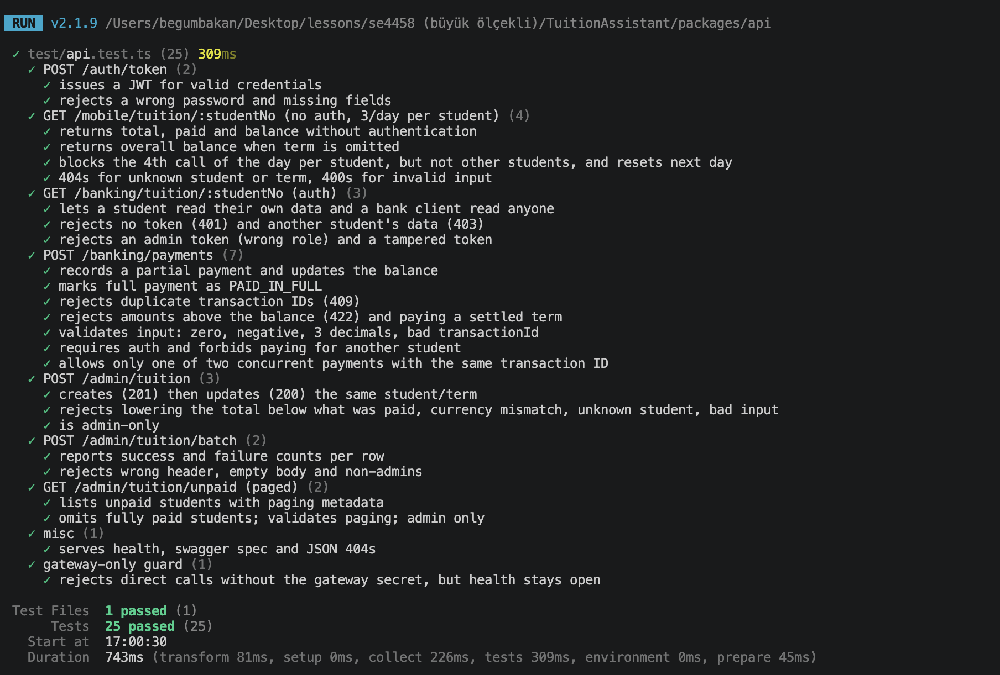

**MCP: 6 passed**

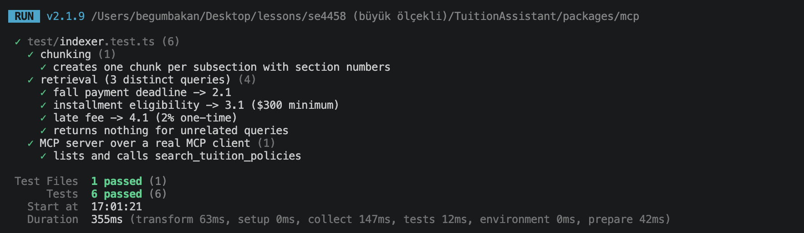

**Agent: 9 passed**

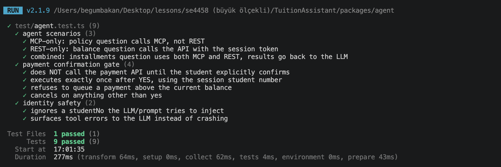

---

## 11. Run locally

Prerequisites: Node 22+, PostgreSQL (e.g. Postgres.app), Docker Desktop and a Gemini API key.

```bash
npm install
psql -c "CREATE DATABASE tuition;"
```

Start each service in its own terminal:

| Service | Folder | Command |
|---|---|---|
| API | `packages/api` | `DATABASE_URL=postgres://<user>@localhost:5432/tuition JWT_SECRET=local-dev-secret-123456 SEED_DEMO_DATA=true GATEWAY_SECRET=local-gateway-key npm run dev` |
| MCP | `packages/mcp` | `npm run build-index && npm run build && npm start` |
| Kong | repo root | `docker build -t tuition-gateway gateway` then `docker run --rm -p 8000:8000 -e DECK_JWT_SECRET=local-dev-secret-123456 -e DECK_API_UPSTREAM=http://host.docker.internal:3000 -e DECK_GATEWAY_KEY=local-gateway-key tuition-gateway` |
| Agent | `packages/agent` | `export GEMINI_API_KEY=...` then `npm run build && npm start` |

Open http://localhost:3002. `JWT_SECRET` must equal `DECK_JWT_SECRET`, and `GATEWAY_SECRET` must equal `DECK_GATEWAY_KEY`.

---

## 12. Cloud deployment (Azure)

| Resource | Service | Notes |
|---|---|---|
| `tuition-rg` | Resource group | Sweden Central |
| `tuitionbegum18818` | Azure Container Registry (Basic) | stores the 4 images |
| `tuition-env` | Container Apps environment (Consumption, express) | shared environment for the 4 apps |
| `tuition-pg-16987` | Azure Database for PostgreSQL – Flexible Server | PostgreSQL 16, Burstable B1ms, 32 GB; firewall allows Azure services only; TLS required |
| `tuition-api` | Container App | port 3000; gateway-secret enforced |
| `tuition-gateway` | Container App | Kong, port 8000, public HTTPS entry point |
| `tuition-mcp` | Container App | port 4000 |
| `tuition-agent` | Container App | port 3002; max 1 replica (in-memory chat sessions) |

**Secrets** (database URL, JWT secret, gateway key, Gemini key) are stored as **Container Apps secrets** and passed to the apps with `secretref:`. None are in the repository.

### Deployment steps
```bash
# 1. Build the images for linux/amd64 and push them to ACR
#    (ACR Tasks / az acr build is not permitted on the student subscription, so images are built locally)
docker login <acr>.azurecr.io -u <acr-user>
docker buildx build --platform linux/amd64 --build-arg PKG=api   -t <acr>.azurecr.io/tuition-api:v1   --push .
docker buildx build --platform linux/amd64 --build-arg PKG=mcp   -t <acr>.azurecr.io/tuition-mcp:v1   --push .
docker buildx build --platform linux/amd64 --build-arg PKG=agent -t <acr>.azurecr.io/tuition-agent:v1 --push .
docker buildx build --platform linux/amd64 -t <acr>.azurecr.io/tuition-gateway:v1 --push gateway

# 2. Base resources (Azure CLI / Cloud Shell)
az group create -n tuition-rg -l swedencentral
az acr create -n <acr> -g tuition-rg --sku Basic --admin-enabled true
az containerapp env create -n tuition-env -g tuition-rg -l swedencentral

# 3. PostgreSQL Flexible Server (created in the portal: B1ms, 32 GB, PostgreSQL 16,
#    public access with "Allow Azure services" only), plus a database named "tuition"

# 4. Container Apps (REG = --registry-server/--registry-username/--registry-password)
az containerapp create -n tuition-api -g tuition-rg --environment tuition-env $REG \
  --image <acr>.azurecr.io/tuition-api:v1 --target-port 3000 --ingress external \
  --secrets db-url=... jwt-secret=... gateway-secret=... \
  --env-vars DATABASE_URL=secretref:db-url JWT_SECRET=secretref:jwt-secret GATEWAY_SECRET=secretref:gateway-secret SEED_DEMO_DATA=true

az containerapp create -n tuition-gateway -g tuition-rg --environment tuition-env $REG \
  --image <acr>.azurecr.io/tuition-gateway:v1 --target-port 8000 --ingress external \
  --secrets jwt-secret=... gateway-secret=... \
  --env-vars DECK_JWT_SECRET=secretref:jwt-secret DECK_GATEWAY_KEY=secretref:gateway-secret DECK_API_UPSTREAM=https://<api-fqdn> \
             KONG_TRUSTED_IPS=0.0.0.0/0,::/0 KONG_REAL_IP_HEADER=X-Forwarded-For KONG_REAL_IP_RECURSIVE=on

az containerapp create -n tuition-mcp -g tuition-rg --environment tuition-env $REG \
  --image <acr>.azurecr.io/tuition-mcp:v1 --target-port 4000 --ingress external

# Agent (created in the portal with the same settings; max replicas 1)
az containerapp create -n tuition-agent -g tuition-rg --environment tuition-env $REG \
  --image <acr>.azurecr.io/tuition-agent:v1 --target-port 3002 --ingress external --max-replicas 1 \
  --secrets gemini-key=... \
  --env-vars GEMINI_API_KEY=secretref:gemini-key GATEWAY_URL=https://<gateway-fqdn> MCP_URL=https://<mcp-fqdn>/mcp GEMINI_MODEL=gemini-3.1-flash-lite
```

**Why the API has an external address:** the Container Apps *express* environment doesn't allow plain-HTTP internal calls (`allowInsecure`), and Kong's request to the internal-only address was rejected by the environment proxy (404). The API therefore has a normal HTTPS address, and **gateway-only access is enforced by the API itself**: every request without Kong's `X-Gateway-Secret` header is refused with `403 GATEWAY_ONLY`.

---

## 13. Assumptions and design decisions

- **Currency and money:** amounts are in USD (matching the policy document), stored in cents. Inputs accept at most 2 decimals; more returns 400. No rounding is applied.
- **Student numbers:** exactly 11 digits (e.g. `23070000101`). **Terms:** `YYYY-FALL`, `YYYY-SPRING` or `YYYY-SUMMER`.
- **Query Tuition scope:** `term` is optional. Without it, the overall balance across all terms is returned with a per-term breakdown.
- **Add Tuition duplicates:** `(studentNo, term)` is unique. A repeat call **updates** the total (200 `UPDATED`). It's rejected if the new total is below the amount already paid, or if the currency differs from the student's existing currency.
- **Batch:** each CSV row is validated and saved independently. The response gives total / succeeded / failed counts with per-row errors. Max 1000 rows.
- **Pay Tuition:** payments are per term, partial payments are allowed, duplicate transaction IDs return 409, and amounts above the balance return 422. Students may only pay their own tuition; admins can't record payments. Payments are simulated (no card processing).
- **Mobile limit:** 3 queries per student per **UTC** day; the 4th returns 429. Keyed by student number, not IP.
- **Identity:** taken only from the JWT, never from the prompt or LLM tool arguments.
- **Installments:** the agent explains eligibility (balance ≥ $300, §3.1) but never claims approval (§3.4).
- **Off-topic questions:** the system prompt limits the agent to tuition topics. This is prompt-level; the security rules (identity, confirmation, authorization) are enforced in code.
- **LLM cost:** Gemini free tier (Google AI Studio project without billing), so **0 TL**. All unit tests use a fake LLM, so grading needs no key.
- **Cloud cost:** Container Apps scale to zero when idle; PostgreSQL B1ms with 32 GB is covered by Azure for Students free services. Resources are deleted after grading (`az group delete -n tuition-rg`).
- **Demo data:** the seed accounts and passwords are fictitious and public by design.
- **Possible production improvements:** managed identity instead of the ACR admin user, Azure Key Vault for secrets, a VNet-integrated environment so the API can be fully internal, and per-user rate limits (`limit_by: credential`) once each user has a Kong consumer.
